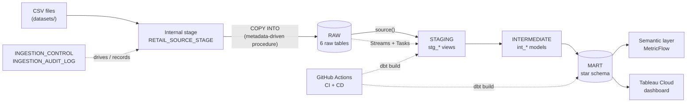
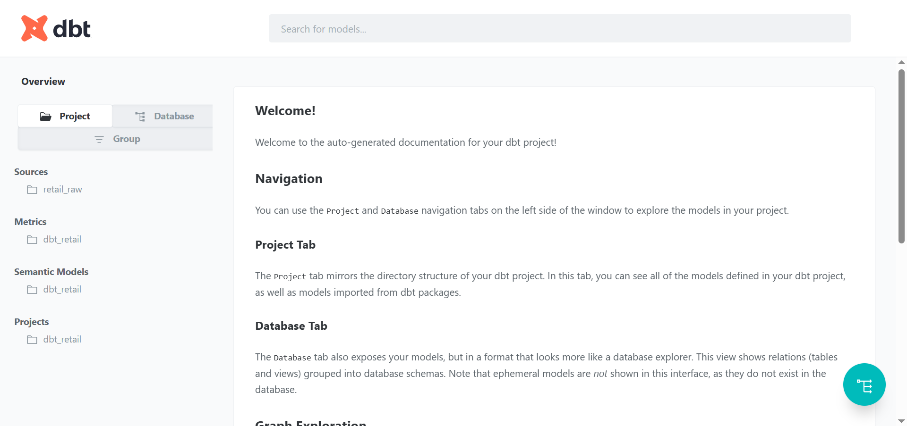
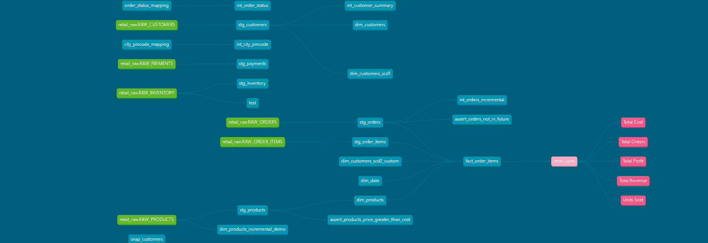
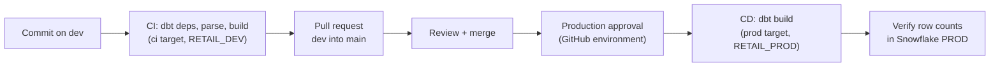
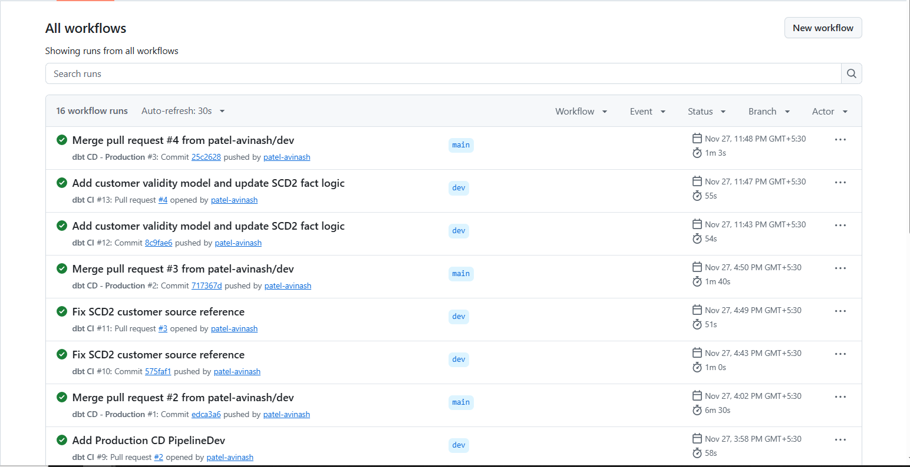
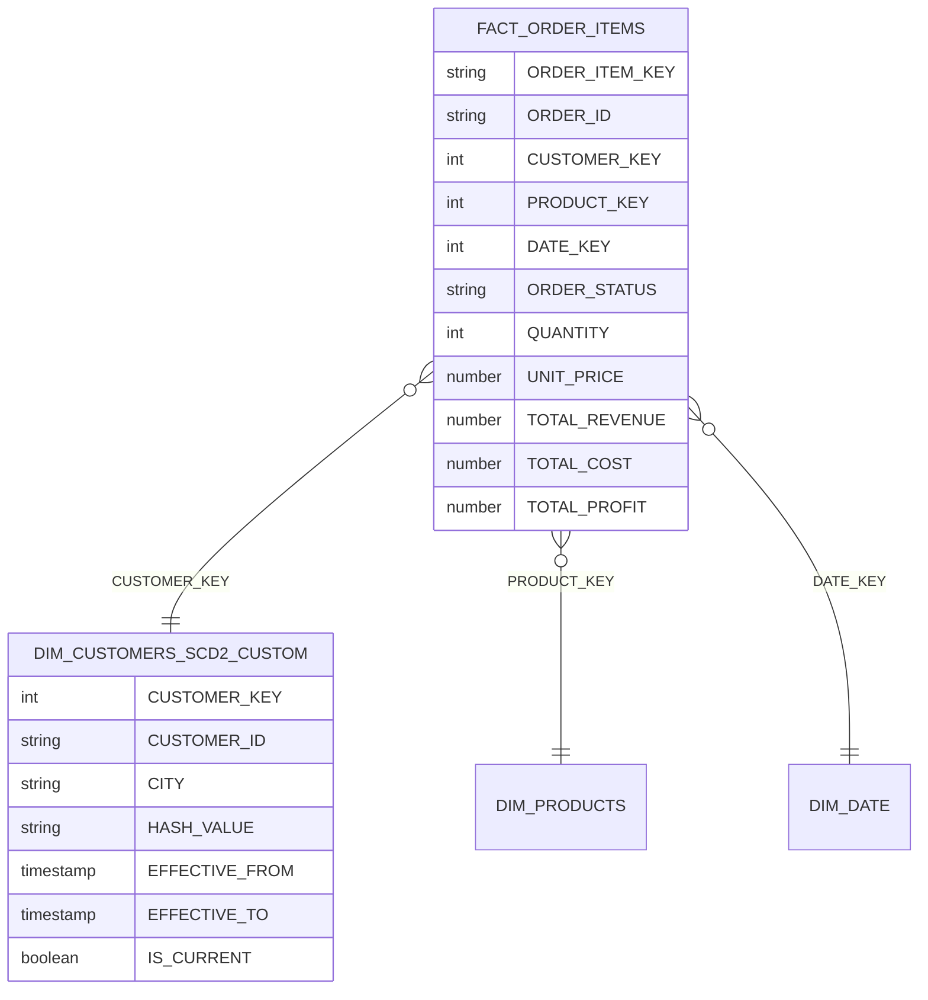
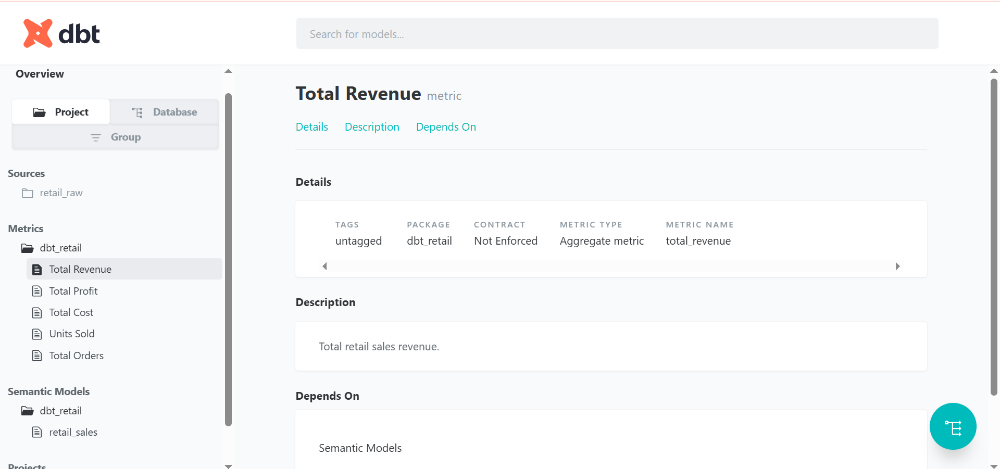

# Retail Sales Data Warehouse & Analytics Platform

An end-to-end data engineering project for an Indian e-commerce retailer, built on **Snowflake + dbt Core + GitHub Actions + Tableau Cloud**.

Raw CSV files (customers, products, orders, order items, payments, inventory) are loaded into Snowflake, transformed with dbt into a star schema with historical (SCD Type 2) customer tracking, exposed through a semantic layer and a Tableau dashboard, and deployed to production through a CI/CD pipeline.

> **Author:** Avinash Patel ([@patel-avinash](https://github.com/patel-avinash))


*Tableau dashboard built on the Snowflake MART layer: revenue, profit and order KPIs, monthly trend, order status and category sales.*

---

## 1. Business problem

The company receives daily CSV extracts and wants a trusted warehouse that answers:

- What is our daily and monthly revenue?
- Which products and categories generate the most profit?
- Who are our most valuable customers?
- How did customer city/status change over time, and do old orders still report the *old* city?
- Can new data be processed automatically every day?
- Can business users read trusted metrics straight from a BI tool?

---

## 2. Architecture at a glance



**Layer responsibilities**

| Layer | Schema | What lives here |
|---|---|---|
| RAW | `RAW` | Source data exactly as loaded, plus `INGESTED_AT`. No cleaning. |
| STAGING | `STAGING` | One cleaned model per source table (trim, case, rename). Same grain as the source. |
| INTERMEDIATE | `STAGING` (same schema, views) | Reusable joins, seed-based lookups, summaries. |
| MART | `MART` | Business-ready facts and dimensions. This is what BI reads. |

---

## 3. End-to-end data flow

| Step | What happens | Where it is implemented |
|---|---|---|
| 1. Source files | Six CSVs plus daily incremental files (new / updated / duplicate rows). | `datasets/` |
| 2. Staging area | Files are uploaded to a Snowflake internal stage. | `snowflake/stages/` |
| 3. Ingestion | A control table lists which file goes to which table. A stored procedure reads it, skips files already loaded, runs `COPY INTO`, and writes an audit row. | `INGESTION_CONTROL`, `PROCESS_RETAIL_INGESTION` (JavaScript), `SP_PROCESS_RETAIL_INGESTION` (Python) |
| 4. Scheduling | A Snowflake Task calls the procedure every 5 minutes. | `RETAIL_INGESTION_TASK`, `RETAIL_INGESTION_TASK_PYTHON` |
| 5. Change processing | Streams on RAW tables feed Tasks that `MERGE` inserts/updates into STAGING targets. A Dynamic Table demo shows the alternative. | `snowflake/streams_tasks/` |
| 6. Transformation | dbt builds staging → intermediate → mart models, runs tests, checks source freshness. | `dbt_retail/` |
| 7. History tracking | Customers are tracked with SCD Type 1, a custom SHA-256 SCD Type 2, and a dbt snapshot. | `dbt_retail/models/marts/`, `dbt_retail/snapshots/` |
| 8. Fact loading | `fact_order_items` joins each order item to the customer version that was valid on the order date. | `dbt_retail/models/marts/fact_order_items.sql` |
| 9. Validation and alerts | Snowpark validation procedures, a parent/child orchestration procedure, a procedure audit log, and email alerts on failure. | `snowflake/stored_procedures/`, `snowpark/` |
| 10. Serving | Five MetricFlow metrics and a Tableau dashboard read from MART. | `dbt_retail/models/marts/semantic_models.yml`, `dashboards/` |
| 11. Deployment | Push to `dev` runs CI. PR to `main` plus approval runs CD against `RETAIL_PROD`. | `.github/workflows/` |

### dbt documentation and lineage

The dbt docs site is generated with `dbt docs generate` and viewed locally with `dbt docs serve`. It documents sources, models, tests, metrics and semantic models.



The lineage graph (DAG) below comes from the same site. Green nodes are RAW sources, blue nodes are models, seeds and tests, and pink nodes are semantic-layer metrics.



---

## 4. Infrastructure

### 4.1 Snowflake

| Item | Value |
|---|---|
| Databases | `RETAIL_DEV` (build and test), `RETAIL_PROD` (validated production) |
| Schemas | `RAW`, `STAGING`, `MART` in each database |
| Warehouse | `COMPUTE_WH` (X-Small, auto-suspend 300 s) |
| Stage / file format | `RETAIL_DEV.RAW.RETAIL_SOURCE_STAGE` / `RETAIL_DEV.RAW.RETAIL_CSV_FORMAT` |
| Control table | `RETAIL_DEV.RAW.INGESTION_CONTROL` (6 active configurations) |
| Audit tables | `INGESTION_AUDIT_LOG` (file level), `PROCEDURE_AUDIT_LOG` (procedure level) |
| Streams | 6 (one per RAW table), e.g. `CUSTOMERS_STREAM` |
| Stream Tasks | 6 `PROCESS_*_STREAM_TASK`, each guarded by `SYSTEM$STREAM_HAS_DATA` |
| Ingestion Tasks | `RETAIL_INGESTION_TASK` (JavaScript procedure), `RETAIL_INGESTION_TASK_PYTHON` (Python procedure). Both are suspended by default to save credits. |
| Email | Notification integration `RETAIL_EMAIL_INT` |

### 4.2 Role-based access control

| Role | RAW | STAGING | MART | Purpose |
|---|---|---|---|---|
| `DATA_ENGINEER` | USAGE + create objects | none | none | Ingestion and RAW operations |
| `DBT_DEVELOPER` | USAGE + SELECT | USAGE + create | USAGE + create | dbt development and CI |
| `BI_ANALYST` | **no access** | no access | USAGE + SELECT | Dashboards (cannot touch RAW) |
| `DBT_PROD_DEPLOYER` | read | create | create | Production deployment from CD |

Roles are granted to `SYSADMIN` so it inherits their privileges. Security was tested with `USE SECONDARY ROLES NONE` so results reflect the primary role only.

### 4.3 dbt

| Target | Used by | Database / schema | Role |
|---|---|---|---|
| `ci` | GitHub Actions CI | `RETAIL_DEV` / `CI` | `DBT_DEVELOPER` |
| `dev` | Local development | `RETAIL_DEV` / `MART` | `DBT_DEVELOPER` |
| `prod` | GitHub Actions CD | `RETAIL_PROD` | `DBT_PROD_DEPLOYER` |

Credentials are read from environment variables (`SNOWFLAKE_ACCOUNT`, `SNOWFLAKE_USER`, `SNOWFLAKE_PASSWORD`). Nothing secret is committed.

Versions: dbt Core 1.12.7, dbt-snowflake 1.12.5, Python 3.12 in CI.

### 4.4 GitHub

| Item | Value |
|---|---|
| Branches | `dev` (integration) and `main` (release) |
| CI workflow | `.github/workflows/dbt-ci.yml`: runs on push to `dev`, PRs to `main`, and manual dispatch. Installs dbt, runs `dbt deps`, `dbt parse`, `dbt build` on the `ci` target. |
| CD workflow | `.github/workflows/dbt-cd.yml`: runs after merge to `main` or manually. Uses the protected `production` environment, then `dbt build` on the `prod` target. |
| Protection | `production` environment requires a reviewer and is limited to `main`. |
| Secrets | Snowflake credentials stored as GitHub secrets (repository for CI, environment for CD). |

### 4.5 CI/CD flow



Workflow history from GitHub Actions. `dbt CI` runs on `dev` pushes and pull requests, and `dbt CD - Production` runs after merges to `main`:



### 4.6 Tableau

Tableau Cloud connects to `RETAIL_DEV.MART` over Cloud OAuth using a virtual connection. The dashboard shows revenue, profit and order KPIs, a monthly trend, an order-status breakdown, and sales by category, with date, category and status filters.

---

## 5. Star schema



**Grain:** one row per order item.

**Key rule:** the fact table joins to the customer version valid on the order date, so a customer who moved from Ahmedabad to Pune still shows Ahmedabad on old orders:

```sql
ON order.CUSTOMER_ID = customer_version.CUSTOMER_ID
AND order.ORDER_DATE >= TO_DATE(customer_version.MATCH_EFFECTIVE_FROM)
AND order.ORDER_DATE <  TO_DATE(customer_version.EFFECTIVE_TO)   -- half-open interval
```

**Customer history approaches built:** SCD Type 1 (`dim_customers_scd1`), custom SCD Type 2 with SHA-256 change detection (`dim_customers_scd2_custom`), and a dbt snapshot (`snap_customers`).

---

## 6. Semantic layer

The `retail_sales` semantic model sits on `fact_order_items` with `dim_date` as the time spine.

| Metric | Logic |
|---|---|
| `total_revenue` | `SUM(TOTAL_REVENUE)` |
| `total_profit` | `SUM(TOTAL_PROFIT)` |
| `total_cost` | `SUM(TOTAL_COST)` |
| `units_sold` | `SUM(QUANTITY)` |
| `total_orders` | `COUNT(DISTINCT ORDER_ID)` |

Defined in `dbt_retail/models/marts/semantic_models.yml` (MetricFlow requires it inside the dbt project). Each metric also appears in the dbt docs site:



---

## 7. Repository layout

```text
retail-data-platform/
├── README.md                     <- this file
├── .gitignore
├── .github/workflows/
│   ├── dbt-ci.yml                CI on dev pushes and PRs
│   └── dbt-cd.yml                production CD with approval gate
├── datasets/
│   ├── baseline/                 customers, products, orders, order_items, payments, inventory
│   └── incremental/              day_01/, day_02/ ... new, updated, duplicate rows
├── snowflake/
│   ├── setup/                    databases, schemas, warehouse checks
│   ├── security/                 roles, grants, RBAC tests (DEV + PROD, incl. deployer role)
│   ├── stages/                   stage, file format, RAW tables, COPY INTO, control + audit tables
│   ├── streams_tasks/            streams, stream Tasks, Dynamic Table demo, ingestion Tasks
│   ├── stored_procedures/        PROCESS_RETAIL_INGESTION, validation + parent/child procedures
│   ├── recovery/                 Time Travel, UNDROP, zero-copy clone demos
│   └── operations/               credit monitoring, suspend/resume Tasks
├── snowpark/                     Python procedure notes and source
├── dbt_retail/
│   ├── dbt_project.yml
│   ├── profiles.yml              env-var based, no secrets
│   ├── models/
│   │   ├── _sources.yml
│   │   ├── staging/              stg_*.sql + _staging.yml
│   │   ├── intermediate/         int_*.sql
│   │   └── marts/                dim_*, fact_order_items, customer_initial_validity, semantic_models.yml
│   ├── macros/                   clean_string.sql
│   ├── seeds/                    order_status_mapping.csv, city_pincode_mapping.csv
│   ├── snapshots/                snap_customers.sql
│   └── tests/                    singular tests
├── semantic_layer/               pointer README to the YAML inside dbt_retail
├── dashboards/                   Tableau dashboard screenshot and notes
└── docs/
    ├── README.md                 documentation index
    ├── architecture.md
    ├── images/                   dbt lineage DAG, GitHub Actions runs
    └── phases/                   phase_01 ... phase_08 notes
```

---

## 8. Project phases

| Phase | Topic | Main output |
|---|---|---|
| 1 | Snowflake foundation and security | DEV/PROD databases, schemas, roles, RBAC tests |
| 2 | Ingestion and Snowflake internals | Stage, file format, RAW tables, `COPY INTO`, audit basics |
| 3 | dbt Core | Staging models, macro, seeds, tests, freshness, docs |
| 4 | Star schema and SCD | Facts, dimensions, SCD1, custom SCD2, snapshot |
| 5 | Incremental processing and automation | Streams, Tasks, Dynamic Table, metadata-driven ingestion |
| 6 | Snowpark and stored procedures | Validation, parent/child procedures, audit log, email alerts |
| 7 | Semantic layer, BI, recovery | MetricFlow metrics, Tableau dashboard, Time Travel, UNDROP, clone |
| 8 | CI/CD and production deployment | GitHub Actions CI/CD, approval gate, PROD deployment |

---

## 9. How to run

```bash
# 1. Python environment
python -m venv venv
source venv/bin/activate            # Windows: venv\Scripts\activate
pip install dbt-snowflake==1.12.5

# 2. Credentials (never commit these)
export SNOWFLAKE_ACCOUNT=...
export SNOWFLAKE_USER=...
export SNOWFLAKE_PASSWORD=...

# 3. Build the dbt project against DEV
cd dbt_retail
dbt deps
dbt debug --target dev
dbt build --target dev

# 4. Docs and lineage
dbt docs generate --target dev
dbt docs serve
```

Snowflake objects must exist first: run the scripts in `snowflake/setup`, `snowflake/security`, then `snowflake/stages` in that order.

---

## 10. Status and known limitations

Stated plainly so the project is described accurately.

- **Duplicate-file protection is filename based.** A changed file with the same name is skipped; a renamed copy of the same file can load again. No checksum logic.
- **Business-key duplicates exist in RAW customers:** 2,030 rows, 2,022 distinct IDs (8 duplicate groups). They were detected by validation, not removed by the ingestion procedure.
- **Streams/Tasks demo handles inserts and updates only.** Delete propagation is not implemented.
- **dbt incremental demo uses an `INGESTED_AT` watermark**, which can miss late-arriving or same-timestamp rows.
- **SCD2 baseline date is an assumption.** `customer_initial_validity` sets 2025-01-01 for every customer because the synthetic data has no real creation dates.
- **Product-price SCD2 is not implemented.**
- **Python ingestion Task:** created and resumed, but a completed scheduled run and a load of a genuinely new file through the Python procedure were not demonstrated.
- **Tableau reads MART tables directly.** It does not consume the MetricFlow semantic layer. Only `total_revenue` and `total_profit` were queried through MetricFlow.
- **dbt docs are generated and viewed locally.** Static hosting is still pending.
- **Customer-key generation** uses `MAX(key) + ROW_NUMBER()`, which is safe for single-user runs but not for concurrent writers.

---

## 11. Security notes

- Credentials live in environment variables and GitHub secrets only.
- `BI_ANALYST` cannot read or modify RAW.
- Production deploys need reviewer approval on the `production` GitHub environment.
- `venv/`, `logs/`, `target/`, `dbt_packages/` and any `.env` file are git-ignored.

---

## 12. Cost note

The ingestion and stream Tasks run on `COMPUTE_WH` every one to five minutes and consume credits while resumed. They are kept suspended except when demonstrating the pipeline:

```sql
SHOW TASKS IN ACCOUNT;
ALTER TASK RETAIL_DEV.RAW.RETAIL_INGESTION_TASK SUSPEND;
ALTER TASK RETAIL_DEV.RAW.RETAIL_INGESTION_TASK_PYTHON SUSPEND;
ALTER DYNAMIC TABLE RETAIL_DEV.STAGING.DT_PRODUCTS_DEMO SUSPEND;
```
