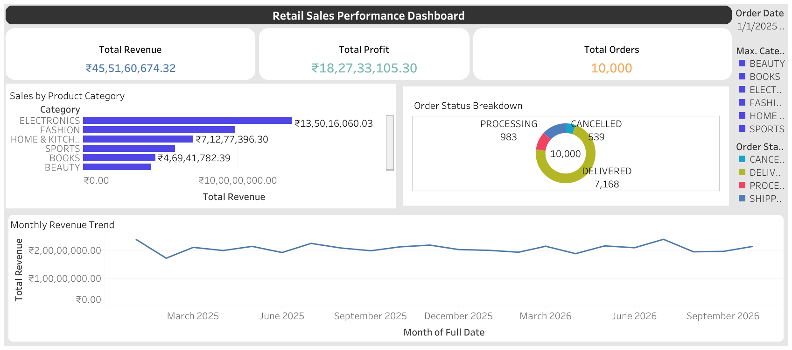

# Retail Sales Performance Dashboard

An interactive Tableau dashboard built for the Retail Data Platform
project. It presents retail sales performance using curated dimensional
data in Snowflake.

## Dashboard Preview



> Add the dashboard screenshot to this folder and name it
> `retail_sales_dashboard.png`.

## Workbook Details

-   **Workbook:** `retail_sales_dashboard.twbx`
-   **Dashboard:** Retail Sales Performance Dashboard
-   **BI tool:** Tableau
-   **Data platform:** Snowflake
-   **Published Tableau connection:**
    `Retail Sales Snowflake Connection`
-   **Environment referenced by the workbook:** `RETAIL_DEV`
-   **Warehouse:** `COMPUTE_WH`

The workbook connects to Snowflake through a Tableau Cloud published
virtual connection. It does not contain a self-contained extract of the
Snowflake data. Anyone opening the workbook must have access to the
published Tableau connection and the required Snowflake environment, or
update the connection to an accessible environment.

## Data Sources

The workbook uses these curated tables from the Snowflake `MART` schema:

  ------------------------------------------------------------------------
  Table                                Purpose
  ------------------------------------ -----------------------------------
  `RETAIL_DEV.MART.FACT_ORDER_ITEMS`   Order-item-level sales facts and
                                       measures

  `RETAIL_DEV.MART.DIM_DATE`           Date attributes for time-based
                                       analysis

  `RETAIL_DEV.MART.DIM_PRODUCTS`       Product attributes and category
                                       analysis
  ------------------------------------------------------------------------

### Data Relationships

-   `FACT_ORDER_ITEMS` is related to `DIM_DATE` using `DATE_KEY`.
-   `FACT_ORDER_ITEMS` is related to `DIM_PRODUCTS` using the product
    key.

The fact table provides the sales measures, while the dimension tables
provide descriptive context for filtering and analysis.

## Dashboard Contents

### KPI Cards

-   **Total Revenue** --- sum of sales revenue.
-   **Total Profit** --- sum of sales profit.
-   **Total Orders** --- distinct order count.

### Visual Analysis

-   **Sales by Product Category** --- compares revenue across product
    categories.
-   **Order Status Breakdown** --- shows the distribution of orders by
    status.
-   **Monthly Revenue Trend** --- tracks revenue by month.

### Filters

The dashboard provides filters for:

-   Order Date
-   Product Category
-   Order Status

These controls allow users to narrow the analysis to a selected period,
category, or order status.

## How to Open

1.  Download `retail_sales_dashboard.twbx`.
2.  Open the workbook using Tableau Desktop.
3.  When prompted, connect using `Retail Sales Snowflake Connection`, or
    configure an available Snowflake connection.
4.  Confirm that the connection points to the required database, schema,
    and tables.
5.  Refresh the data if prompted.

> **Environment note:** The workbook currently references `RETAIL_DEV`.
> Before using it as a production-facing dashboard, update the Tableau
> connection to the corresponding production tables in `RETAIL_PROD` and
> validate the results.

## Project Context

This dashboard is the BI deliverable for the Retail Data Platform
project. The upstream data is loaded into Snowflake and transformed
using dbt through the RAW, STAGING, INTERMEDIATE, and MART layers.

The project also includes a dbt Semantic Layer model validated
separately with MetricFlow. Tableau connects directly to the curated
Snowflake MART tables through the published Tableau virtual connection;
it does **not** consume MetricFlow directly.

## Repository Files

``` text
dashboards/
├── README.md
├── retail_sales_dashboard.twbx
└── retail_sales_dashboard.png
```

## Notes

-   The screenshot is a visual preview; the `.twbx` file is the Tableau
    workbook.
-   Dashboard figures may change when the workbook is refreshed against
    the connected Snowflake data.
-   Do not commit Snowflake passwords, personal access tokens, or other
    credentials to this repository.
