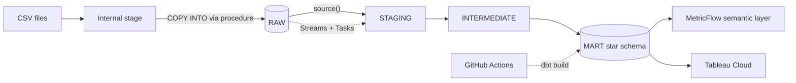
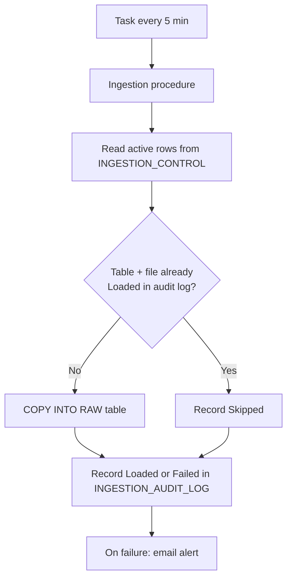

# Architecture

## 1. Overview

CSV files are loaded into Snowflake, transformed by dbt into a star schema, exposed through a semantic layer and Tableau, and deployed through GitHub Actions.

## 2. Layers

| Layer | Schema | Purpose |
|---|---|---|
| RAW | `RAW` | Source data as loaded, with `INGESTED_AT`. No cleaning. |
| STAGING | `STAGING` | One cleaned view per source table. |
| INTERMEDIATE | `STAGING` | Reusable joins, seed lookups, summaries. |
| MART | `MART` | Facts and dimensions for BI. |

## 3. Environments

| Environment | Database | Used by | dbt target | Role |
|---|---|---|---|---|
| CI | `RETAIL_DEV` (schema `CI`) | GitHub Actions CI | `ci` | `DBT_DEVELOPER` |
| DEV | `RETAIL_DEV` | Local development | `dev` | `DBT_DEVELOPER` |
| PROD | `RETAIL_PROD` | GitHub Actions CD | `prod` | `DBT_PROD_DEPLOYER` |

## 4. Snowflake objects

| Object | Name |
|---|---|
| Warehouse | `COMPUTE_WH` (X-Small) |
| Stage | `RETAIL_DEV.RAW.RETAIL_SOURCE_STAGE` |
| File format | `RETAIL_DEV.RAW.RETAIL_CSV_FORMAT` |
| RAW tables | `RAW_CUSTOMERS`, `RAW_PRODUCTS`, `RAW_ORDERS`, `RAW_ORDER_ITEMS`, `RAW_PAYMENTS`, `RAW_INVENTORY` |
| Control table | `INGESTION_CONTROL` |
| Audit tables | `INGESTION_AUDIT_LOG`, `PROCEDURE_AUDIT_LOG` |
| Streams | 6, one per RAW table |
| Stream Tasks | 6 `PROCESS_*_STREAM_TASK` |
| Ingestion Tasks | `RETAIL_INGESTION_TASK`, `RETAIL_INGESTION_TASK_PYTHON` |
| Procedures | `PROCESS_RETAIL_INGESTION` (JS), `SP_PROCESS_RETAIL_INGESTION`, `SP_VALIDATE_CUSTOMERS`, `SP_RUN_CUSTOMER_VALIDATION` (Python) |
| Email | `RETAIL_EMAIL_INT` |

## 5. Ingestion flow

## 6. Star schema

- **Fact:** `fact_order_items`, one row per order item.
- **Dimensions:** `dim_customers_scd2_custom` (versioned), `dim_products`, `dim_date`.
- **Historical join:** each order item maps to the customer version valid on the order date, using a half-open interval (`>= effective_from` and `< effective_to`).

## 7. Security

| Role | RAW | STAGING | MART |
|---|---|---|---|
| `DATA_ENGINEER` | create and load | none | none |
| `DBT_DEVELOPER` | read | create | create |
| `BI_ANALYST` | none | none | read |
| `DBT_PROD_DEPLOYER` | read | create | create |

Credentials come from environment variables and GitHub secrets. Production deploys need approval on the `production` GitHub environment.

## 8. Key design decisions

| Decision | Reason |
|---|---|
| Separate DEV and PROD databases | Test before promoting |
| RAW keeps source data untouched | Cleaning and dedup belong downstream and stay auditable |
| `INGESTED_AT` is not used as `EFFECTIVE_FROM` | Technical load time is not business validity |
| `customer_initial_validity` as a dbt model | A manually created table would not exist in PROD |
| `dbt build` in CI and CD | Runs models and tests together |
| Control table drives ingestion | New sources need configuration, not new pipelines |

## 9. Known limitations

See the "Status and known limitations" section of the root README.
