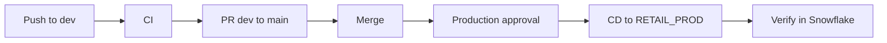

# Phase 8: CI/CD and Production Deployment

## Objective
Replace manual dbt runs with a reviewed, automated release path.

## Flow

## Workflows
- `dbt-ci.yml`: triggers on push to `dev`, PR to `main`, manual. Python 3.12, `dbt-snowflake 1.12.5`, `dbt deps`, `dbt parse`, `dbt build` on the `ci` target.
- `dbt-cd.yml`: triggers on `main` or manual. Uses the protected `production` environment (required reviewer, `main` only) and the `prod` target.

## dbt targets
`ci` (`RETAIL_DEV`, schema `CI`), `dev` (`RETAIL_DEV.MART`), `prod` (`RETAIL_PROD`, role `DBT_PROD_DEPLOYER`). Credentials come from environment variables backed by GitHub secrets.

## Customer validity fix
Synthetic data had no real customer start dates, so early orders could fall before the first SCD2 version and fail to match.
- Added `customer_initial_validity` as a dbt model (2,022 customers, assumed 2025-01-01).
- Switched `fact_order_items` from `source()` to `ref()`.
- Left `INGESTED_AT` untouched because it is load time, not business validity.
- A manually created helper table would have been missing in PROD, which is why it became a model.

## Production verification (PR #4)
- `CUSTOMER_INITIAL_VALIDITY`: 2,022 rows.
- `FACT_ORDER_ITEMS`: 25,000 rows and 25,000 distinct keys.
- Revenue 455,160,674.32; profit 182,733,105.30, matching DEV.

## Open items
The CD run showed one annotation warning whose text was not recorded. Read it in GitHub Actions before calling the run clean. The 2025-01-01 date is an assumption; real systems need source history or an approved business rule.
